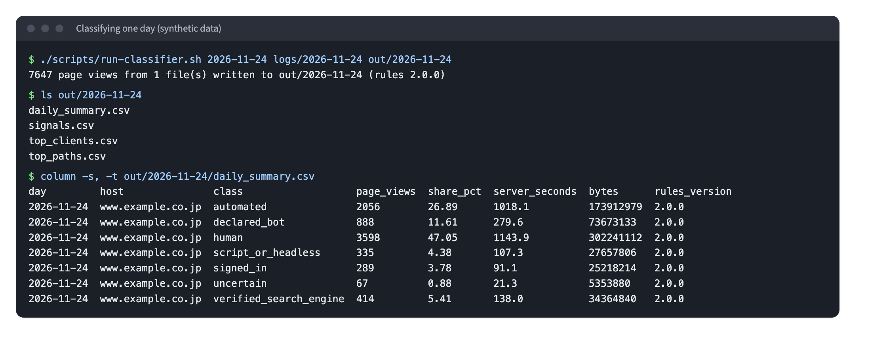

# 4. Classify the Traffic
{: .no_toc }

1. TOC
{:toc}

## Goal

Score every page view and sort it into one of seven classes, per UTC day.

## Steps

1. Download the scripts into a `scripts/` folder:
   [classify_traffic.py](files/scripts/classify_traffic.py),
   [fetch-enrichment.sh](files/scripts/fetch-enrichment.sh) and
   [run-classifier.sh](files/scripts/run-classifier.sh), and make the shell scripts executable.
1. Download the enrichment data: cloud provider address ranges, Tor exit nodes and, if `geoipupdate` is set up, the
   MaxMind GeoLite2 network and country databases. Run it weekly:

    
    ```bash
    #!/usr/bin/env bash
    # Download the IP enrichment data used by classify_traffic.py --data.
    # Run weekly. Usage: fetch-enrichment.sh [data-dir]   (default: data)
    set -euo pipefail
    DATA="${1:-data}"
    mkdir -p "$DATA"
    curl -fsSL https://ip-ranges.amazonaws.com/ip-ranges.json -o "$DATA/aws.json"
    curl -fsSL https://www.gstatic.com/ipranges/cloud.json -o "$DATA/gcp.json"
    curl -fsSL https://docs.oracle.com/iaas/tools/public_ip_ranges.json -o "$DATA/oracle.json"
    curl -fsSL https://check.torproject.org/torbulkexitlist -o "$DATA/tor-exits.txt"

    # Azure publishes its ranges as a weekly file whose URL changes each week.
    # Copy the current "Azure IP Ranges and Service Tags - Public Cloud" download
    # link from Microsoft's download page into AZURE_SERVICE_TAGS_URL to include it.
    if [ -n "${AZURE_SERVICE_TAGS_URL:-}" ]; then
      curl -fsSL "$AZURE_SERVICE_TAGS_URL" -o "$DATA/azure.json"
    else
      echo "note: AZURE_SERVICE_TAGS_URL not set; Azure addresses will not be flagged" >&2
    fi

    # Optional network owner and country data (MaxMind GeoLite2, free account and
    # licence key required; attribution required when results are shared).
    # Configure GeoIP.conf with EditionIDs GeoLite2-ASN GeoLite2-Country, then:
    if command -v geoipupdate >/dev/null 2>&1; then
      geoipupdate -d "$DATA"
    else
      echo "note: geoipupdate not installed; network owner and country will be empty" >&2
    fi
    ```
    

    ```bash
    ./scripts/fetch-enrichment.sh data
    ```

1. Set a secret salt for the IP hashes: a random value of at least 16 characters, kept out of source control. The
   classifier refuses to run without it.

    ```bash
    export TM_SALT="$(openssl rand -hex 24)"   # store it in your secret manager and reuse it
    ```

1. Classify one UTC day. Pass all of that day's files in one run: the honeypot and "no interaction all day" signals
   are worked out per day.

    ```bash
    ./scripts/run-classifier.sh 2026-11-24 logs/2026-11-24 out/2026-11-24
    ```

    This runs `classify_traffic.py` with the enrichment data, the beacon checks and search engine verification by
    DNS. Add `--detail` to the command in `run-classifier.sh` for one row per page view; that file is large and
    contains personal data, so it is off by default.

## The classes

Only `GET` responses with status 200 or 304 and an HTML content type count as page views. Redirects, errors,
assets, the beacon and the honeypot do not.

| Class | Meaning |
| --- | --- |
| `human` | Passed the bot checks, no signed-in cookie |
| `signed_in` | Passed the bot checks and sent a Liferay session-state cookie |
| `uncertain` | Some bot signals, not enough to decide (score 30–59) |
| `automated` | Score 60 or more, including clients that sent a signed-in cookie |
| `script_or_headless` | User agent of an HTTP library or a headless browser |
| `declared_bot` | Says it is a bot, or claims a search engine that could not be verified |
| `verified_search_engine` | Search engine confirmed by reverse and forward DNS |

## The main signals

Each signal adds to a page view's score; 60 or more is `automated`.

| Signal | Weight | Fires when |
| --- | --- | --- |
| Honeypot | 100 | The same IP and user agent requested the hidden link that day |
| Fake search engine | 80 | It claims to be Googlebot, Bingbot or similar, and DNS says no |
| Webdriver | 60 | The beacon reported `navigator.webdriver` |
| Spam query | 40 | The query string carries links or spam words |
| No beacon | 35 | No `load` beacon for this page within 2 minutes |
| Datacenter IP | 25 | Cloud or hosting provider address |
| No Sec-Fetch headers | 25 | A Chrome or Firefox user agent without the headers real ones send |
| High rate | 25 | More than 30 pages a minute from one client |
| Few assets | 20 | Loads pages but hardly any CSS, JavaScript or images |

Smaller signals cover missing `Accept-Language`, missing client hints, a generic `Accept` header, no cookie on a
repeat visit, Tor exit nodes, machine-regular timing, outdated browsers and browsers that read `robots.txt`.

{: .important }
The signed-in cookie (`LFR_SESSION_STATE_…`) can be sent by any client, so it never skips the checks: it only
labels page views that already look human. Search engine verification first checks that reverse DNS works; if it
doesn't, claims count as `declared_bot` instead of being called fake.

## Check


{: .screenshot }

`out/2026-11-24/` contains `daily_summary.csv`, `signals.csv`, `top_clients.csv` and `top_paths.csv`, and the
summary's `share_pct` values for the day add up to 100.
