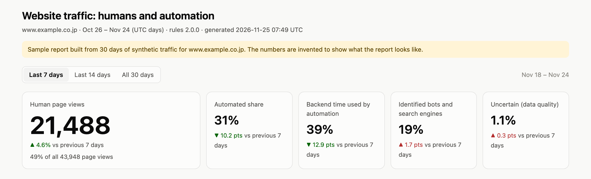
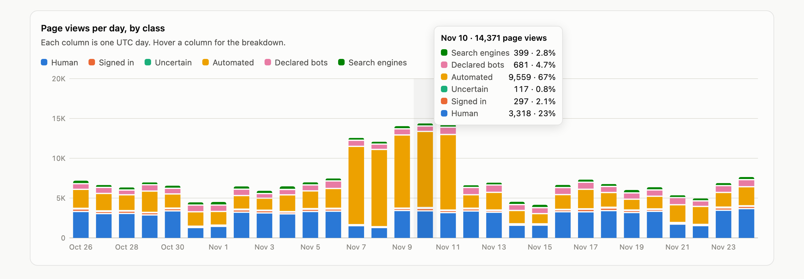
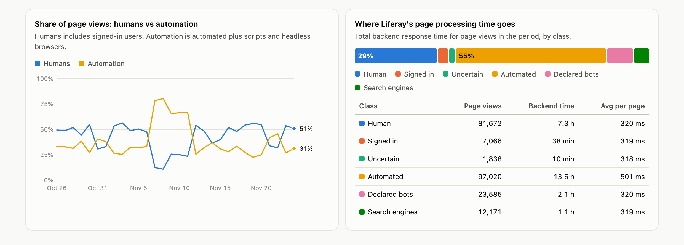
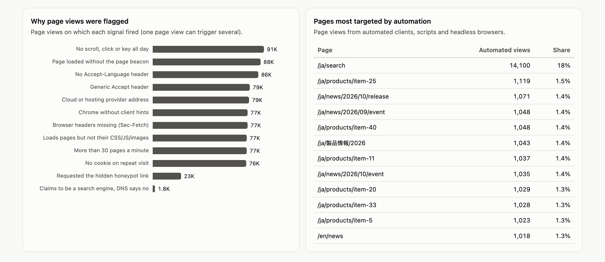
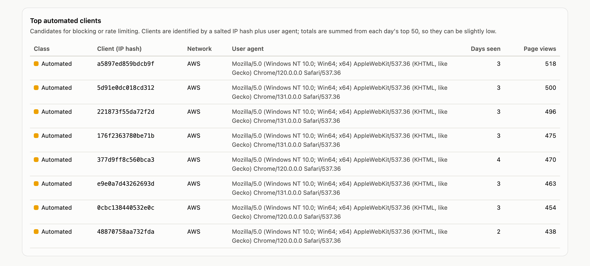

# 5. Build the Dashboard
{: .no_toc }

1. TOC
{:toc}

## Goal

Turn the classifier's results into a single HTML dashboard you can open offline or attach to an email.

## Steps

1. Download [build_report.py](files/scripts/build_report.py) into the `scripts/` folder.
1. Build the dashboard from all the days classified so far. `--in` is searched recursively, so one folder per day
   works, and it can be repeated:

    ```bash
    python3 scripts/build_report.py --in out --out report.html \
      --title "www.example.com: humans and automation"
    ```

1. Open `report.html` in a browser. It has no external dependencies, and contains only totals, salted IP hashes and
   user agents.

See the [sample dashboard](files/samples/sample-report.html), built from 30 days of synthetic traffic. To rebuild it
yourself, run [make_sample_logs.py](files/samples/make_sample_logs.py) with AWS's `ip-ranges.json`, then the
classifier and `build_report.py`.

## Reading it

The screenshots below come from the sample dashboard.

### Headline figures

Choose the last 7, 14 or 30 days at the top. Where the data covers the previous period too, each figure shows the
change against it, coloured by whether the change is good: here, the automated share fell by 10.2 points, which is
good, so it is green.


{: .screenshot }

| Figure | Question it answers |
| --- | --- |
| Human page views | How much real traffic does the site get, and is it growing? |
| Automated share | How much of the traffic is bots that don't identify themselves? |
| Backend time used by automation | How much of Liferay's page processing goes to bots? |
| Identified bots and search engines | How much comes from crawlers that announce themselves? |
| Uncertain (data quality) | Can the numbers be trusted? If this share grows, the rules need tuning. |

### Day by day

When did bot traffic spike? Hover a column for that day's breakdown. In the sample, a five-day scraping campaign
stands out in the middle of the period.


{: .screenshot }

### Mix and cost

The share chart shows whether the mix of humans and automation is changing. The processing-time chart shows which
classes cost the most backend time, with the average per page: bots often hit expensive pages such as search, so
their share of backend time can be well above their share of page views.


{: .screenshot }

### Why and where

Which signals drive the classification, and which pages the bots are after.


{: .screenshot }

### Clients to block

The automated clients with the most page views: candidates for blocking or rate limiting, with their cloud
provider, user agent and the number of days they were seen. Below this, **Daily numbers** shows the same data as a
table.


{: .screenshot }

{: .note }
The top clients are summed from each day's top 50, so their totals can be slightly low. The network column shows
the cloud provider; with MaxMind GeoLite2 set up it also shows the network owner and country.

## Check

The dashboard's date range matches the days you classified, and its human page views for a day match the sum of the
`human` and `signed_in` rows in that day's `daily_summary.csv`.
