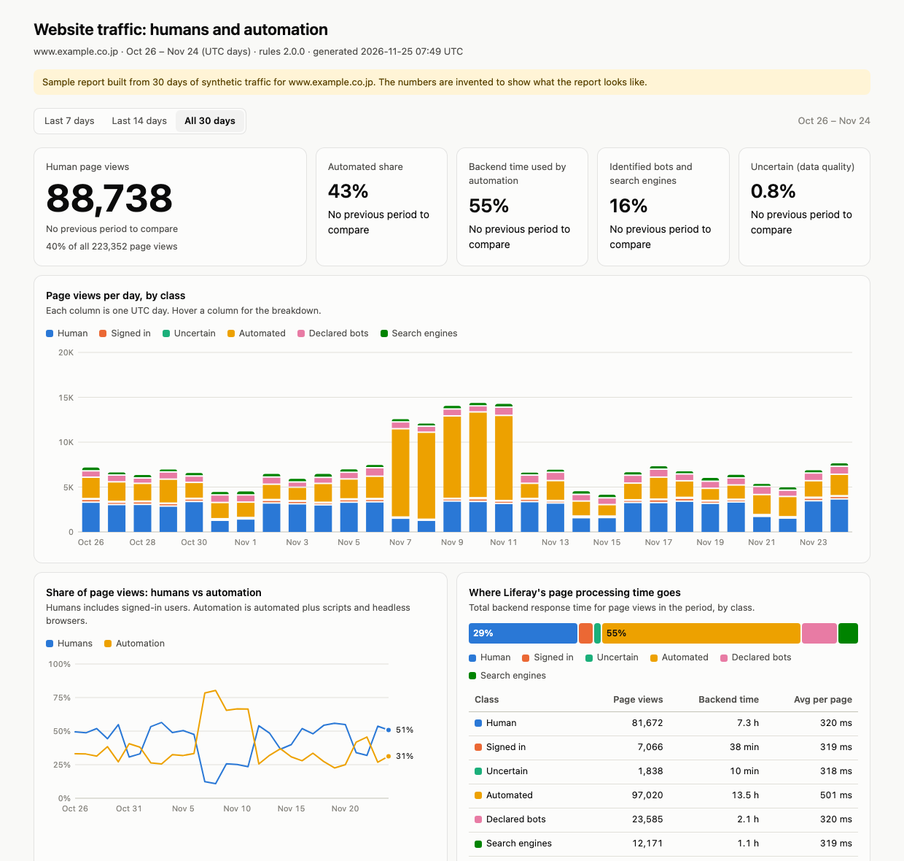
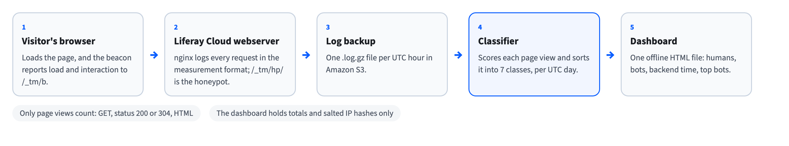

# Measure Human and Bot Traffic on Liferay Cloud
{: .no_toc }

How much of your site's traffic is real people? This tutorial adds measurement to a Liferay Cloud (PaaS) site's
`webserver` service and turns its access logs into a daily dashboard of human page views, bot traffic, and the
backend time bots consume. It is for Liferay Cloud administrators, and for consultants answering "how much of our
traffic is bots?" or "what should we block?".

{: .screenshot }

1. TOC
{:toc}

## What You'll Build

{: .screenshot }

| Part | What it does |
| --- | --- |
| **Measurement log format** | The webserver logs each request with the headers that tell browsers and bots apart. |
| **Page beacon** | A global JavaScript client extension that reports page loads, interaction and browser automation to nginx. |
| **Honeypot** | A hidden link that only clients ignoring `robots.txt` follow. |
| **Classifier** | A Python script that scores every page view and sorts it into seven classes, from *human* to *verified search engine*. |
| **Dashboard** | A single, offline HTML file: human page views, automated share, backend time used by bots, the pages bots target, and the clients worth blocking. See the [sample dashboard](chapters/files/samples/sample-report.html). |

The logs themselves are collected by the
[Back Up Liferay Cloud Webserver Logs](../liferay-cloud-webserver-log-backup/) tutorial, which accepts this log
format and writes one file per UTC hour to S3.

Every file is on this site: [download them all as a zip](chapters/files/paas-traffic-measurement.zip), or one at a
time from each chapter.

## Before You Start

- **Liferay Cloud:** a Liferay Cloud (PaaS) project with a `webserver` service, and access to its repository to
  change the webserver's configuration. Tested with the `liferaycloud/nginx:1.31.0-6.8.0` webserver image.
- **Liferay DXP:** a version that supports client extensions, for the page beacon.
- **The log backup:** the [log backup tutorial](../liferay-cloud-webserver-log-backup/) set up, or another way to get
  the webserver logs.
- **Tools:** Python 3.10 or later and `curl`. Optional: `pip install geoip2` and a free
  [MaxMind GeoLite2](https://dev.maxmind.com/geoip/geolite2-free-geolocation-data) account for network owner and
  country.
- **Privacy:** agreement from the site owner's privacy contact. The logs contain IP addresses, URLs and browser
  details (see [chapter 6](chapters/privacy-and-limits.html)).
- **Time:** about half a day, then a few days of data before the dashboard is useful.

## Chapters

| Chapter | What you do |
| --- | --- |
| [1. Turn On the Measurement Log Format](chapters/log-format.html) | Change the webserver's log format and add its nginx config. |
| [2. Add the Beacon and Honeypot](chapters/beacon-and-honeypot.html) | Deploy the beacon client extension, the hidden link and the `robots.txt` rule. |
| [3. Collect the Logs](chapters/collect-logs.html) | Get each day's logs, from the S3 backup or directly. |
| [4. Classify the Traffic](chapters/classify.html) | Download the enrichment data and run the classifier. |
| [5. Build the Dashboard](chapters/dashboard.html) | Turn the classifier's results into the HTML dashboard. |
| [6. Privacy, Tuning and Limits](chapters/privacy-and-limits.html) | What the data contains, how to tune the rules, and what isn't measured. |

## Status

*Partly tested.* The nginx config and log format are accepted by the Liferay Cloud webserver image. Simulated
traffic sent through nginx with the same log format and client IP settings was classified as intended: human
visitors on English and Japanese pages, a spoofed Googlebot, scripts and browser-like scrapers sending a fake
signed-in cookie, a signed-in browser, a person sharing an IP address with a honeypot-hitting bot, and redirects and
404s. The classifier handled 200,000 lines with 40,000 distinct IP addresses in about 20 seconds, and the dashboard
was built from 30 days of synthetic traffic.

Not yet tested: a deployment on a real Liferay Cloud environment, the beacon client extension in a real DXP, and
whether `LFR_SESSION_STATE_` cookies are set only for signed-in users in your DXP version.
