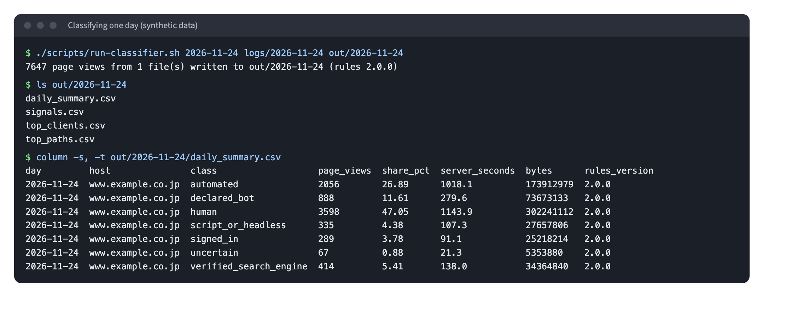

# 4. トラフィックを分類する
{: .no_toc }

1. TOC
{:toc}

## 目的

UTC の 1 日ごとに、すべてのページビューにスコアを付け、7 つのクラスのいずれかに分類します。

## 手順

1. 次のスクリプトを `scripts/` フォルダにダウンロードし、シェルスクリプトに実行権限を付けます：[classify_traffic.py](../../chapters/files/scripts/classify_traffic.py)、[fetch-enrichment.sh](../../chapters/files/scripts/fetch-enrichment.sh)、[run-classifier.sh](../../chapters/files/scripts/run-classifier.sh)。
1. 補足データをダウンロードします。クラウド事業者のアドレス範囲、Tor の出口ノード、そして `geoipupdate` を設定していれば MaxMind GeoLite2 のネットワークと国のデータベースです。毎週実行してください。

    
    ```bash
    #!/usr/bin/env bash
    # Download the IP enrichment data used by classify_traffic.py --data.
    # Run weekly. Usage: fetch-enrichment.sh [data-dir]   (default: data)
    set -euo pipefail
    DATA="${1:-data}"
    mkdir -p "$DATA"
    curl -fsSL https://ip-ranges.amazonaws.com/ip-ranges.json -o "$DATA/aws.json"
    curl -fsSL https://www.gstatic.com/ipranges/cloud.json -o "$DATA/gcp.json"
    curl -fsSL https://docs.oracle.com/iaas/tools/public_ip_ranges.json -o "$DATA/oracle.json"
    curl -fsSL https://check.torproject.org/torbulkexitlist -o "$DATA/tor-exits.txt"

    # Azure publishes its ranges as a weekly file whose URL changes each week.
    # Copy the current "Azure IP Ranges and Service Tags - Public Cloud" download
    # link from Microsoft's download page into AZURE_SERVICE_TAGS_URL to include it.
    if [ -n "${AZURE_SERVICE_TAGS_URL:-}" ]; then
      curl -fsSL "$AZURE_SERVICE_TAGS_URL" -o "$DATA/azure.json"
    else
      echo "note: AZURE_SERVICE_TAGS_URL not set; Azure addresses will not be flagged" >&2
    fi

    # Optional network owner and country data (MaxMind GeoLite2, free account and
    # licence key required; attribution required when results are shared).
    # Configure GeoIP.conf with EditionIDs GeoLite2-ASN GeoLite2-Country, then:
    if command -v geoipupdate >/dev/null 2>&1; then
      geoipupdate -d "$DATA"
    else
      echo "note: geoipupdate not installed; network owner and country will be empty" >&2
    fi
    ```
    

    ```bash
    ./scripts/fetch-enrichment.sh data
    ```

1. IP ハッシュ用の秘密のソルトを設定します。16 文字以上のランダムな値で、ソース管理には含めません。ソルトがないと分類スクリプトは実行されません。

    ```bash
    export TM_SALT="$(openssl rand -hex 24)"   # シークレット管理ツールに保存して再利用します
    ```

1. UTC の 1 日分を分類します。その日のファイルをすべて 1 回の実行で渡してください。ハニーポットと「1 日中操作なし」のシグナルは 1 日単位で判定されます。

    ```bash
    ./scripts/run-classifier.sh 2026-11-24 logs/2026-11-24 out/2026-11-24
    ```

    これは、補足データ、ビーコンの確認、DNS による検索エンジンの検証を有効にして `classify_traffic.py` を実行します。ページビューごとに 1 行の出力が必要な場合は、`run-classifier.sh` のコマンドに `--detail` を追加します。このファイルは大きく、個人データを含むため、既定では出力しません。

## クラス

ページビューとして数えるのは、ステータスが 200 または 304 で、コンテンツタイプが HTML の `GET` レスポンスだけです。リダイレクト、エラー、静的ファイル、ビーコン、ハニーポットは数えません。

| クラス | 意味 |
| --- | --- |
| `human` | ボットのチェックを通過し、サインイン Cookie がない |
| `signed_in` | ボットのチェックを通過し、Liferay のセッション状態 Cookie を送っている |
| `uncertain` | ボットのシグナルがいくつかあるが、判断できない（スコア 30〜59） |
| `automated` | スコア 60 以上。サインイン Cookie を送ったクライアントも含む |
| `script_or_headless` | HTTP ライブラリーまたはヘッドレスブラウザーのユーザーエージェント |
| `declared_bot` | ボットであることを名乗っている、または検証できなかった検索エンジンを名乗っている |
| `verified_search_engine` | 逆引きと正引きの DNS で確認できた検索エンジン |

## 主なシグナル

各シグナルがページビューのスコアに加算され、60 以上で `automated` になります。

| シグナル | 重み | 発生する条件 |
| --- | --- | --- |
| ハニーポット | 100 | 同じ IP とユーザーエージェントが、その日に隠しリンクにアクセスした |
| 偽の検索エンジン | 80 | Googlebot や Bingbot などを名乗っているが、DNS で否定された |
| Webdriver | 60 | ビーコンが `navigator.webdriver` を報告した |
| スパムのクエリ | 40 | クエリ文字列にリンクやスパムの単語が含まれる |
| ビーコンなし | 35 | そのページの `load` ビーコンが 2 分以内に届かなかった |
| データセンターの IP | 25 | クラウドやホスティング事業者のアドレス |
| Sec-Fetch ヘッダーなし | 25 | Chrome や Firefox を名乗っているのに、本物が送るヘッダーがない |
| 高頻度 | 25 | 1 つのクライアントから 1 分あたり 30 ページを超える |
| 静的ファイルが少ない | 20 | ページは読み込むが、CSS、JavaScript、画像をほとんど読み込まない |

このほか、`Accept-Language` の欠落、クライアントヒントの欠落、汎用的な `Accept` ヘッダー、再訪時に Cookie がない、Tor の出口ノード、機械的に規則正しい間隔、古いブラウザー、`robots.txt` を読むブラウザーといった小さなシグナルがあります。

{: .important }
サインイン Cookie（`LFR_SESSION_STATE_…`）はどのクライアントからでも送れるため、チェックを省略する理由にはなりません。すでに人に見えるページビューに印を付けるだけです。検索エンジンの検証では、まず逆引き DNS が使えることを確認し、使えない場合は、偽物と判定せずに `declared_bot` として数えます。

## 確認


{: .screenshot }

`out/2026-11-24/` に `daily_summary.csv`、`signals.csv`、`top_clients.csv`、`top_paths.csv` があり、サマリーのその日の `share_pct` の合計が 100 になっていれば完了です。
