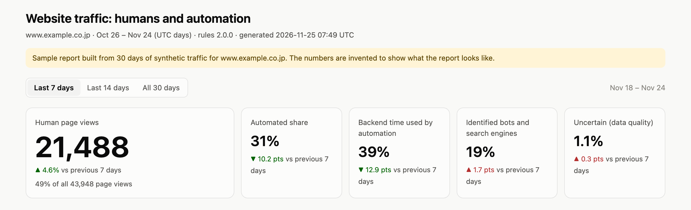
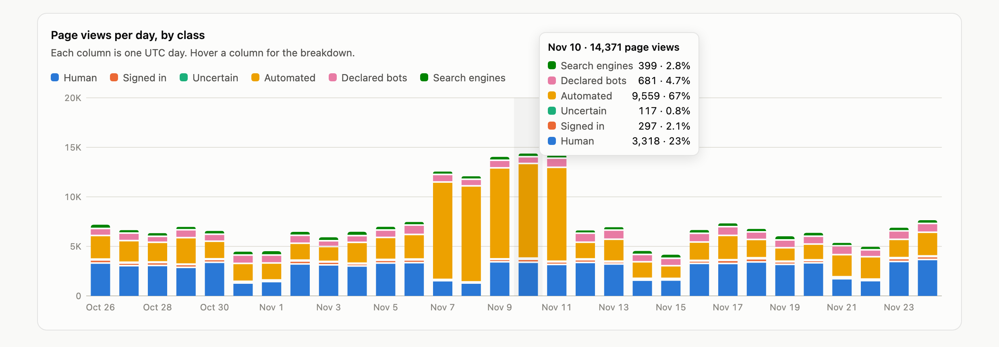
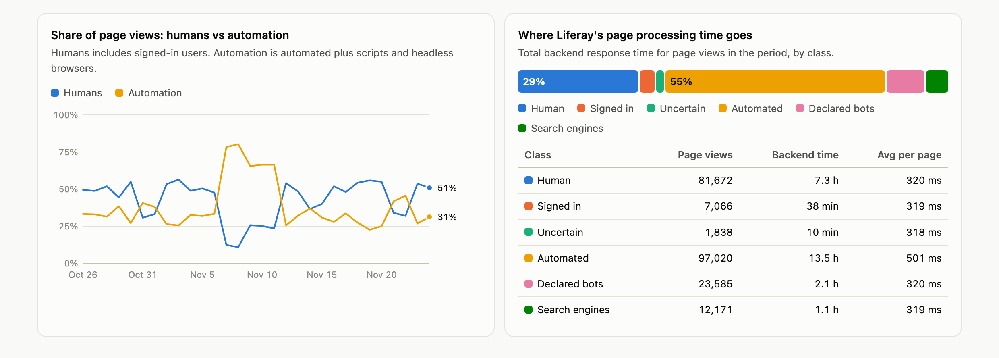
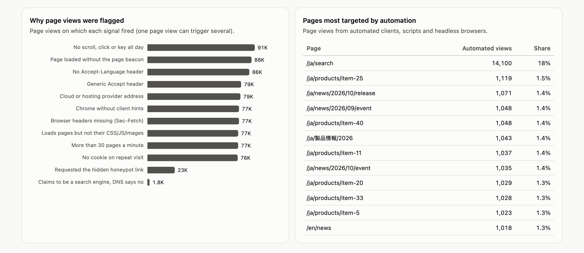
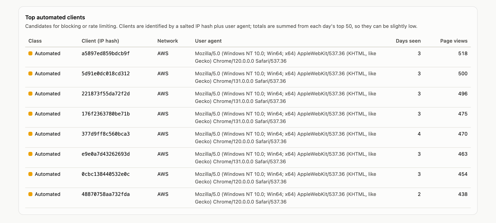

# 5. ダッシュボードを作成する
{: .no_toc }

1. TOC
{:toc}

## 目的

分類結果を、オフラインで開いたりメールに添付したりできる HTML ダッシュボード 1 つにまとめます。

## 手順

1. [build_report.py](../../chapters/files/scripts/build_report.py) を `scripts/` フォルダにダウンロードします。
1. これまでに分類したすべての日からダッシュボードを作成します。`--in` はサブフォルダも検索するので日ごとのフォルダのままで使え、複数回指定することもできます。

    ```bash
    python3 scripts/build_report.py --in out --out report.html \
      --title "www.example.com: humans and automation"
    ```

1. `report.html` をブラウザーで開きます。外部への依存はなく、含まれるのは合計値、ソルト付きの IP ハッシュ、ユーザーエージェントだけです。

30 日分の合成トラフィックから作成した[サンプルのダッシュボード](../../chapters/files/samples/sample-report.html)をご覧ください。自分で作り直すには、AWS の `ip-ranges.json` を指定して [make_sample_logs.py](../../chapters/files/samples/make_sample_logs.py)を実行し、続けて分類スクリプトと `build_report.py` を実行します。

{: .note }
ダッシュボードの画面の表記は英語です。以下のスクリーンショットはサンプルのダッシュボードのものです。

## 見方

### 主要な数値

上部で直近 7 日、14 日、30 日を選びます。前の期間のデータもある場合、各数値には前の期間との差が、良い変化かどうかで色分けされて表示されます。この例では、自動化されたトラフィックの割合（Automated share）が 10.2 ポイント下がったので、良い変化として緑で表示されています。


{: .screenshot }

| 数値 | 答える問い |
| --- | --- |
| Human page views | 本物のトラフィックはどれくらいで、増えているか |
| Automated share | 自分の正体を名乗らないボットのトラフィックはどれくらいか |
| Backend time used by automation | Liferay のページ処理のうち、ボットに使われている割合はどれくらいか |
| Identified bots and search engines | 正体を名乗るクローラーからのトラフィックはどれくらいか |
| Uncertain (data quality) | 数値は信頼できるか。この割合が増えたら、ルールの調整が必要 |

### 日ごとの推移

ボットのトラフィックはいつ急増したか。列にカーソルを合わせると、その日の内訳が表示されます。サンプルでは、期間の中ほどにある 5 日間のスクレイピングが目立っています。


{: .screenshot }

### 構成とコスト

割合のグラフは、人と自動化の比率が変化しているかを示します。処理時間のグラフは、どのクラスがバックエンド時間を最も使っているかを、ページあたりの平均とともに示します。ボットは検索のような負荷の高いページにアクセスすることが多いため、バックエンド時間に占める割合がページビューの割合を大きく上回ることがあります。


{: .screenshot }

### 判定の理由と対象のページ

どのシグナルが分類を左右しているか、ボットがどのページを狙っているかを示します。


{: .screenshot }

### ブロック候補のクライアント

ページビューが最も多い自動化されたクライアントです。ブロックやレート制限の候補として、クラウド事業者、ユーザーエージェント、確認された日数とともに表示されます。その下の **Daily numbers** には、同じデータが表として表示されます。


{: .screenshot }

{: .note }
上位のクライアントは各日の上位 50 件を合計したものなので、合計がわずかに少なくなることがあります。ネットワークの列にはクラウド事業者が表示されます。MaxMind GeoLite2 を設定すると、ネットワーク事業者と国も表示されます。

## 確認

ダッシュボードの日付の範囲が分類した日と一致し、ある日の人のページビューが、その日の `daily_summary.csv` の `human` と `signed_in` の行の合計と一致していれば完了です。
