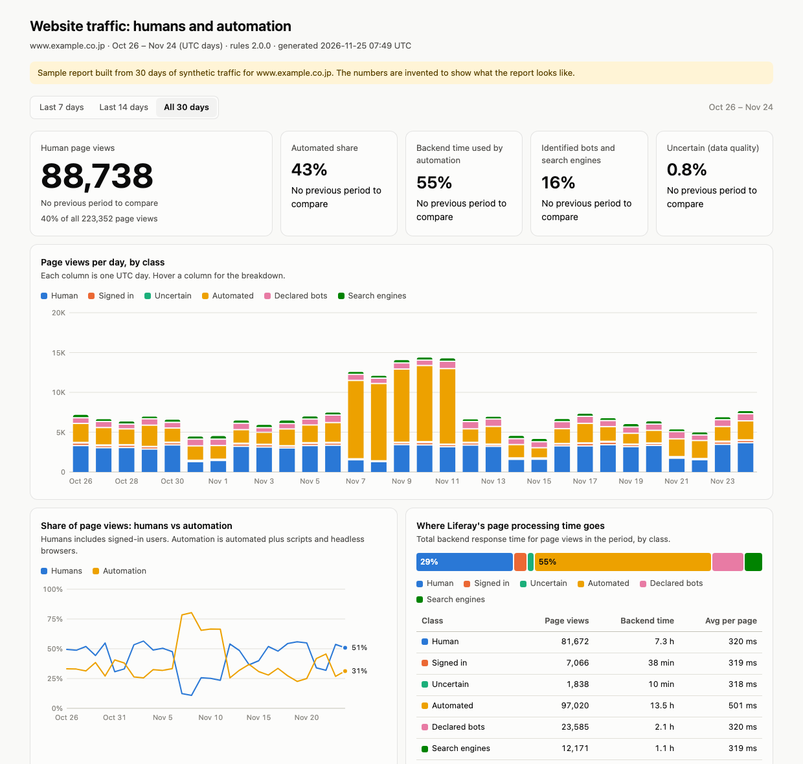
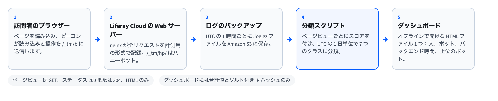

# Liferay Cloud で人とボットのトラフィックを計測
{: .no_toc }

サイトのトラフィックのうち、本物の人によるものはどれくらいでしょうか。このチュートリアルでは、Liferay Cloud（PaaS）サイトの `webserver` サービスに計測の仕組みを追加し、アクセスログを、人のページビュー、ボットのトラフィック、ボットが消費するバックエンド処理時間をまとめた日次ダッシュボードに変換します。対象は、Liferay Cloud の管理者と、「トラフィックのうちボットはどれくらいか」「何をブロックすべきか」という問いに答えるコンサルタントです。

{: .screenshot }

1. TOC
{:toc}

## 作るもの

{: .screenshot }

| 構成要素 | 役割 |
| --- | --- |
| ** 計測用のログ形式 ** | ブラウザーとボットを見分けるためのヘッダーを含めて、Web サーバーがすべてのリクエストを記録します。 |
| ** ページビーコン ** | ページの読み込み、操作、ブラウザーの自動操作を nginx に報告するグローバル JavaScript のクライアントエクステンションです。 |
| ** ハニーポット ** | `robots.txt` を無視するクライアントだけがたどる、隠しリンクです。 |
| ** 分類スクリプト ** | すべてのページビューにスコアを付け、*human* から *verified search engine* までの 7 つのクラスに分類する Python スクリプトです。 |
| ** ダッシュボード ** | オフラインで開ける HTML ファイル 1 つ。人のページビュー、自動化されたトラフィックの割合、ボットが使うバックエンド時間、ボットが狙うページ、ブロック候補のクライアントを表示します。[サンプルのダッシュボード](../chapters/files/samples/sample-report.html)をご覧ください。 |

ログそのものは、[Liferay Cloud の Web サーバーログをバックアップ](../../liferay-cloud-webserver-log-backup/ja/)チュートリアルで収集します。このバックアップは本チュートリアルのログ形式に対応しており、UTC の 1 時間ごとに 1 つのファイルを S3 に保存します。

すべてのファイルはこのサイトにあります。[zip ですべてダウンロード](../chapters/files/paas-traffic-measurement.zip)するか、各章から 1 つずつダウンロードしてください。

## 始める前に

- **Liferay Cloud:** `webserver` サービスを含む Liferay Cloud（PaaS）プロジェクトと、Web サーバーの設定を変更するためのリポジトリへのアクセス。`liferaycloud/nginx:1.31.0-6.8.0` の Web サーバーイメージで検証しています。
- **Liferay DXP:** ページビーコンのため、クライアントエクステンションに対応したバージョン。
- ** ログのバックアップ:** [ログのバックアップのチュートリアル](../../liferay-cloud-webserver-log-backup/ja/)を設定済みであるか、Web サーバーログを取得する別の方法。
- ** ツール:** Python 3.10 以降と `curl`。任意：ネットワーク事業者と国を表示するには、`pip install geoip2` と、無料の[MaxMind GeoLite2](https://dev.maxmind.com/geoip/geolite2-free-geolocation-data) アカウント。
- ** プライバシー:** サイト所有者のプライバシー担当者の同意。ログには IP アドレス、URL、ブラウザーの情報が含まれます（[6 章](chapters/privacy-and-limits.html)を参照）。
- ** 所要時間:** 約半日。その後、ダッシュボードが役立つまでに数日分のデータが必要です。

## 章

| 章 | 内容 |
| --- | --- |
| [1. 計測用のログ形式を有効にする](chapters/log-format.html) | Web サーバーのログ形式を変更し、nginx の設定を追加します。 |
| [2. ビーコンとハニーポットを追加する](chapters/beacon-and-honeypot.html) | ビーコンのクライアントエクステンション、隠しリンク、`robots.txt` のルールをデプロイします。 |
| [3. ログを収集する](chapters/collect-logs.html) | S3 のバックアップから、または直接、日ごとのログを取得します。 |
| [4. トラフィックを分類する](chapters/classify.html) | 補足データをダウンロードし、分類スクリプトを実行します。 |
| [5. ダッシュボードを作成する](chapters/dashboard.html) | 分類結果を HTML のダッシュボードにします。 |
| [6. プライバシー、調整、制限事項](chapters/privacy-and-limits.html) | データに含まれるもの、ルールの調整方法、計測できないことを説明します。 |

## ステータス

* 一部のみ検証済みです。* nginx の設定とログ形式は、Liferay Cloud の Web サーバーイメージで受け入れられることを確認しました。同じログ形式とクライアント IP の設定の nginx に合成トラフィックを送り、意図どおりに分類されることを確認しています：英語と日本語のページを見る人の訪問者、なりすました Googlebot、偽のサインイン Cookie を送るスクリプトとブラウザー型のスクレイパー、サインイン済みのブラウザー、ハニーポットにアクセスするボットと IP アドレスを共有する人、リダイレクトと 404。分類スクリプトは、4 万種類の IP アドレスを含む 20 万行を約 20 秒で処理し、ダッシュボードは 30 日分の合成トラフィックから作成しました。

未検証の項目は、実際の Liferay Cloud 環境へのデプロイ、実際の DXP でのビーコンのクライアントエクステンション、お使いの DXP のバージョンで `LFR_SESSION_STATE_` Cookie がサインイン済みのユーザーにだけ設定されるかどうかです。
