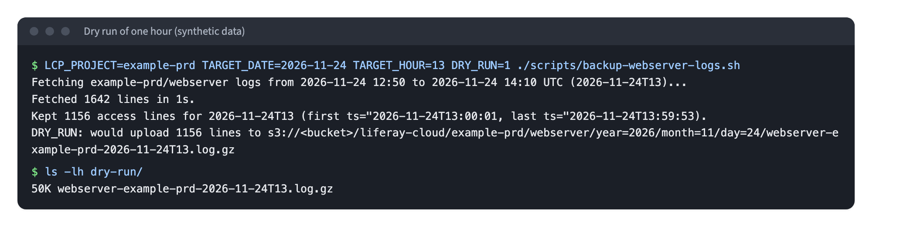

# 4. バックアップスクリプトを追加する
{: .no_toc }

1. TOC
{:toc}

## 目的

UTC の 1 時間分（または 1 日分）の Web サーバーログを取得し、その時間のアクセスログ行だけを残して圧縮し、S3 にアップロードするスクリプトを追加します。

## 手順

1. スクリプトをリポジトリの `scripts/backup-webserver-logs.sh` として保存し（[ダウンロード](../../chapters/files/backup-webserver-logs.sh)）、実行権限を付けます。

    ```bash
    chmod +x scripts/backup-webserver-logs.sh
    ```

1. 内容を確認します。スクリプトは引数を取らず、何をバックアップするかはワークフローが環境変数で指定します。

    
    ```bash
    #!/usr/bin/env bash
    # Back up Liferay Cloud webserver (nginx) access logs to S3, one UTC hour
    # or one UTC day at a time.
    #
    # Usage: backup-webserver-logs.sh   (no arguments; configured by environment)
    #
    # Environment:
    #   LCP_PROJECT  Liferay Cloud environment ID, e.g. myproject-prd    (required)
    #   LCP_SERVICE  Service to read logs from                             (default: webserver)
    #   TARGET_DATE  UTC day to back up, YYYY-MM-DD                         (default: yesterday)
    #   TARGET_HOUR  UTC hour 00-23; empty = the whole day in one file      (default: empty)
    #   S3_BUCKET    Target bucket                                          (required unless DRY_RUN=1)
    #   S3_PREFIX    Key prefix inside the bucket                           (default: liferay-cloud)
    #   DRY_RUN      1 = build the .gz file locally and skip the upload    (default: 0)
    #
    # The scheduled workflow fixes TARGET_DATE to "yesterday" once, in a planning
    # job, and runs this script once per hour in parallel. Re-running a failed
    # hour from GitHub reuses that date, so it backs up the same day as long as
    # the logs are still inside Liferay Cloud's 30-day window.
    #
    # Requires GNU date (Linux), the lcp CLI already logged in, and the AWS CLI.
    #
    # Notes, verified against lcp 3.24.0:
    # - --since/--until take dates such as "2026-11-24 00:00", not "26h".
    # - Without --until, `lcp log` keeps following new lines and never exits.
    # - --limit (max 10000) is entries per request, not a cap on the total. lcp
    #   keeps requesting the next page until the window is exhausted, sleeping
    #   3 s between pages.
    # - Logs are kept for a rolling 30 x 24 hours.

    set -euo pipefail
    export LC_ALL=C TZ=UTC

    : "${LCP_PROJECT:?LCP_PROJECT is not set}"
    LCP_SERVICE="${LCP_SERVICE:-webserver}"
    S3_PREFIX="${S3_PREFIX:-liferay-cloud}"
    DRY_RUN="${DRY_RUN:-0}"
    TARGET_DATE="${TARGET_DATE:-}"
    TARGET_HOUR="${TARGET_HOUR:-}"
    if [ "$DRY_RUN" != 1 ]; then
      : "${S3_BUCKET:?S3_BUCKET is not set}"
    fi

    RETENTION_SECONDS=$(( 30 * 86400 ))
    MARGIN_SECONDS=600       # fetch 10 minutes either side of the chunk
    PAGE_LIMIT=10000         # entries per API request (lcp maximum)
    FETCH_ATTEMPTS=3         # retries for transient API errors
    RETRY_WAIT_SECONDS=60

    die() { echo "ERROR: $*" >&2; exit 1; }

    [ "$#" -eq 0 ] || die "this script takes no arguments; set TARGET_DATE / TARGET_HOUR instead."

    # --- What to back up -------------------------------------------------------
    [ -z "$TARGET_DATE" ] && TARGET_DATE="$(date -d yesterday +%F)"
    [[ "$TARGET_DATE" =~ ^[0-9]{4}-[0-9]{2}-[0-9]{2}$ ]] \
      && [ "$(date -d "$TARGET_DATE" +%F 2>/dev/null)" = "$TARGET_DATE" ] \
      || die "TARGET_DATE must be a valid YYYY-MM-DD date, got '$TARGET_DATE'."

    NGINX_DAY=$(date -d "$TARGET_DATE" +%d/%b/%Y)   # e.g. 24/Nov/2026, as in nginx access lines
    DAY_START=$(date -d "$TARGET_DATE 00:00" +%s)

    if [ -n "$TARGET_HOUR" ]; then
      [[ "$TARGET_HOUR" =~ ^([01][0-9]|2[0-3])$ ]] \
        || die "TARGET_HOUR must be two digits, 00 to 23, got '$TARGET_HOUR'."
      CHUNK_START=$(( DAY_START + 10#$TARGET_HOUR * 3600 ))
      CHUNK_END=$(( CHUNK_START + 3600 ))
      LABEL="${TARGET_DATE}T${TARGET_HOUR}"
      MATCH_DEFAULT="[${NGINX_DAY}:${TARGET_HOUR}:"      # default format, e.g. [24/Nov/2026:13:
      MATCH_TM="ts=\"${TARGET_DATE}T${TARGET_HOUR}:"     # traffic-measurement format, e.g. ts="2026-11-24T13:
    else
      CHUNK_START=$DAY_START
      CHUNK_END=$(( DAY_START + 86400 ))
      LABEL="$TARGET_DATE"
      MATCH_DEFAULT="[${NGINX_DAY}:"
      MATCH_TM="ts=\"${TARGET_DATE}T"
    fi

    NOW=$(date +%s)
    [ "$CHUNK_END" -le "$NOW" ] || die "$LABEL has not finished yet in UTC."
    [ "$CHUNK_START" -ge $(( NOW - RETENTION_SECONDS )) ] \
      || die "$LABEL is no longer complete in Liferay Cloud (30-day rolling retention)."

    SINCE_EPOCH=$(( CHUNK_START - MARGIN_SECONDS ))
    UNTIL_EPOCH=$(( CHUNK_END + MARGIN_SECONDS ))
    [ "$UNTIL_EPOCH" -gt "$NOW" ] && UNTIL_EPOCH=$NOW
    SINCE=$(date -d "@$SINCE_EPOCH" '+%Y-%m-%d %H:%M')
    UNTIL=$(date -d "@$UNTIL_EPOCH" '+%Y-%m-%d %H:%M')

    OUT="webserver-${LCP_PROJECT}-${LABEL}.log"
    KEY="${S3_PREFIX}/${LCP_PROJECT}/${LCP_SERVICE}/year=${TARGET_DATE:0:4}/month=${TARGET_DATE:5:2}/day=${TARGET_DATE:8:2}/${OUT}.gz"

    ORIG_DIR=$PWD
    WORKDIR=$(mktemp -d)
    trap 'rm -rf "$WORKDIR"' EXIT
    cd "$WORKDIR"

    # --- Fetch -------------------------------------------------------------------
    echo "Fetching ${LCP_PROJECT}/${LCP_SERVICE} logs from ${SINCE} to ${UNTIL} UTC (${LABEL})..."
    STARTED=$(date +%s)
    attempt=1
    # stdin from /dev/null: if the session has expired, lcp fails instead of
    # waiting for credentials on stdin.
    until lcp log -p "$LCP_PROJECT" -s "$LCP_SERVICE" \
            --since "$SINCE" --until "$UNTIL" --limit "$PAGE_LIMIT" \
            < /dev/null > raw.log; do
      [ "$attempt" -lt "$FETCH_ATTEMPTS" ] \
        || die "lcp log failed ${FETCH_ATTEMPTS} times. Check the lcp session and project ID."
      echo "lcp log failed (attempt ${attempt}/${FETCH_ATTEMPTS}); retrying in ${RETRY_WAIT_SECONDS}s..." >&2
      sleep "$RETRY_WAIT_SECONDS"
      attempt=$(( attempt + 1 ))
    done
    RAW_LINES=$(wc -l < raw.log)
    echo "Fetched ${RAW_LINES} lines in $(( $(date +%s) - STARTED ))s."

    # --- Filter and compress -----------------------------------------------------
    # Keep only nginx access lines stamped inside the chunk. Two log formats are accepted:
    #   default:              [24/Nov/2026:13:05:01 +0000]
    #   traffic measurement:  ts="2026-11-24T13:05:01+00:00"   (requires the webserver to run in UTC,
    #                                                          which the Liferay Cloud image does)
    grep -F -e "$MATCH_DEFAULT" -e "$MATCH_TM" raw.log > "$OUT" || true
    rm -f raw.log
    LINES=$(wc -l < "$OUT")
    [ "$LINES" -gt 0 ] || die "no access-log lines found for $LABEL (fetched ${RAW_LINES} raw lines)."

    STAMP_RE="\[${NGINX_DAY}:[0-9:]*|ts=\"${TARGET_DATE}T[0-9:]*"
    FIRST=$(head -n 1 "$OUT" | grep -oE "$STAMP_RE" | head -n 1 || true)
    LAST=$(tail -n 1 "$OUT" | grep -oE "$STAMP_RE" | head -n 1 || true)
    echo "Kept ${LINES} access lines for ${LABEL} (first ${FIRST}, last ${LAST})."

    gzip -6 "$OUT"

    # --- Upload ------------------------------------------------------------------
    if [ "$DRY_RUN" = 1 ]; then
      mkdir -p "${ORIG_DIR}/dry-run"
      cp "${OUT}.gz" "${ORIG_DIR}/dry-run/"
      echo "DRY_RUN: would upload ${LINES} lines to s3://${S3_BUCKET:-<bucket>}/${KEY}"
      exit 0
    fi

    aws s3 cp "${OUT}.gz" "s3://${S3_BUCKET}/${KEY}" --sse AES256 --only-show-errors
    echo "Uploaded ${LINES} lines for ${LABEL} to s3://${S3_BUCKET}/${KEY}"
    ```
    

## スクリプトが前提としていること

Liferay Cloud CLI の次の動作は、すべて `lcp` 3.24.0 で確認しました。

- **`--since` と `--until` には日時を指定します。** 例：`"2026-11-24 00:00"`、または `"2 hours ago"` のような相対表現。`26h` のような短縮形はエラーになり、コマンドが失敗します。
- ** 必ず `--until` を指定してください。** 指定しないと、`lcp log` は `tail -f` のように新しい行を待ち続け、終了しません。
- **`--limit` は 1 回のリクエストあたりの件数で、合計ではありません。** 最大は 10,000、既定値は 100 です。CLI は期間全体を読み終えるまでリクエストを繰り返し、リクエストの間に 3 秒待つため、アクセスの多いサイトでは既定値だと非常に遅くなります。`--limit` は `--since` と `--until` の両方を指定したときだけ使えます。
- ** ログの保持期間は分単位で直近 30 × 24 時間 ** なので、最も古い日は常に一部が消えています。スクリプトは、すでに不完全になった時間を拒否します。
- サービスの ** すべてのインスタンス ** のログが出力に含まれます。

抽出処理は、次のどちらかのログ形式で、その時間のタイムスタンプを持つ行を残します。

| 形式 | 行の中のタイムスタンプ |
| --- | --- |
| Web サーバーの既定の形式 | `[24/Nov/2026:13:05:01 +0000]` |
| [トラフィック計測チュートリアル](../../../liferay-cloud-traffic-measurement/ja/)の key=value 形式 | `ts="2026-11-24T13:05:01+00:00"` |

Liferay Cloud では、どちらも UTC です。nginx の `[warn]` や起動時のメッセージなど、タイムスタンプのない行は残りません。

{: .tip }
AWS を使わずにスクリプトを試すには、Linux で `DRY_RUN=1` を付けて実行します。`.gz` ファイルをローカルの `dry-run/` フォルダに書き出し、アップロードは行いません。例：`lcp login` の後に `LCP_PROJECT=<PROJECT_ID> TARGET_HOUR=13 DRY_RUN=1 ./scripts/backup-webserver-logs.sh`。

## 確認

`lcp` にサインインした Linux マシンで、前日の 1 時間分をドライランすると、最後に `DRY_RUN: would upload N lines to s3://…/day=DD/webserver-<PROJECT_ID>-YYYY-MM-DDT13.log.gz` と表示され、その前の行には `13:00` から `13:59` の間の最初と最後のタイムスタンプが表示されます。


{: .screenshot }
