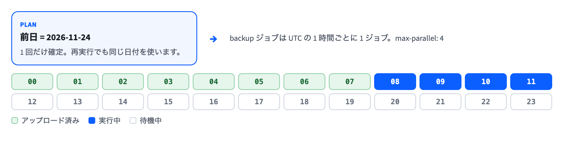

# 5. ワークフローを追加する
{: .no_toc }

1. TOC
{:toc}

## 目的

前日（UTC）分を 1 時間ごとの 24 ジョブでバックアップする、スケジュール実行の GitHub Actions ワークフローを追加します。

## 手順

1. ワークフローを `.github/workflows/backup-webserver-logs.yml` として保存します（[ダウンロード](../../chapters/files/backup-webserver-logs.yml)）。
1. `env` セクションの 4 つの値を設定します：`LCP_PROJECT`、`LCP_SERVICE`（通常は `webserver`）、`S3_BUCKET`、`AWS_REGION`。

    
    ```yaml
    name: Backup Liferay Cloud webserver logs

    # Backs up the previous UTC day as 24 hourly files, fetched in parallel.
    # For a low-traffic environment, set the matrix to a single empty hour ("")
    # to fetch the whole day as one file instead.

    on:
      schedule:
        - cron: "30 1 * * *"          # 01:30 UTC daily (10:30 JST)
      workflow_dispatch:              # manual run; always backs up the previous UTC day

    permissions:
      id-token: write                 # required for AWS OIDC
      contents: read

    concurrency: backup-webserver-logs

    env:
      LCP_PROJECT: <PROJECT_ID>       # e.g. myproject-prd
      LCP_SERVICE: webserver
      S3_BUCKET: <BUCKET>
      AWS_REGION: <AWS_REGION>

    jobs:
      plan:
        # Fixes "yesterday" once for the whole run. Hourly jobs that start late,
        # and failed hours re-run later from GitHub, all use this same date.
        runs-on: ubuntu-latest
        timeout-minutes: 5
        outputs:
          date: ${{ steps.date.outputs.date }}
        steps:
          - id: date
            run: |
              d=$(date -u -d yesterday +%F)
              echo "date=$d" >> "$GITHUB_OUTPUT"
              echo "Backing up $d (UTC)"

      backup:
        needs: plan
        runs-on: ubuntu-latest
        timeout-minutes: 60
        strategy:
          fail-fast: false            # one failed hour must not cancel the others
          max-parallel: 4             # raise only after confirming with Liferay Cloud support
          matrix:
            hour: ["00", "01", "02", "03", "04", "05", "06", "07", "08", "09", "10", "11",
                   "12", "13", "14", "15", "16", "17", "18", "19", "20", "21", "22", "23"]
        name: backup ${{ needs.plan.outputs.date }}T${{ matrix.hour }}
        steps:
          - uses: actions/checkout@v4

          - name: Configure AWS credentials (OIDC)
            uses: aws-actions/configure-aws-credentials@v4
            with:
              role-to-assume: ${{ secrets.AWS_ROLE_ARN }}
              aws-region: ${{ env.AWS_REGION }}

          - name: Install LCP CLI
            run: |
              # Install to a fixed folder: with no terminal attached, the installer
              # exits if its default folder is not writable.
              curl -fsSL https://cdn.liferay.cloud/lcp/stable/latest/install.sh \
                | bash -s stable latest "$HOME/.local/bin"
              echo "$HOME/.local/bin" >> "$GITHUB_PATH"
              "$HOME/.local/bin/lcp" version

          - name: Authenticate LCP CLI
            env:
              LCP_USER: ${{ secrets.LCP_USER }}
              LCP_PASSWORD: ${{ secrets.LCP_PASSWORD }}
            run: |
              # lcp 3.x has no token variable. With --no-browser and piped stdin,
              # it reads "<email> <password>" separated by a single space.
              # The account needs a Liferay Cloud password (SSO-only accounts
              # must set one first), and the password must not contain spaces.
              if [ -z "$LCP_USER" ] || [ -z "$LCP_PASSWORD" ]; then
                echo "::error::Secrets LCP_USER and LCP_PASSWORD must be set."; exit 1
              fi
              case "$LCP_PASSWORD" in
                *" "*) echo "::error::LCP_PASSWORD contains a space, which lcp login cannot read."; exit 1 ;;
              esac
              printf '%s %s' "$LCP_USER" "$LCP_PASSWORD" | lcp login --no-browser > /dev/null
              # Fail here, not later, if the account cannot see the environment.
              lcp list -p "$LCP_PROJECT" < /dev/null

          - name: Back up hour
            env:
              TARGET_DATE: ${{ needs.plan.outputs.date }}
              TARGET_HOUR: ${{ matrix.hour }}
            run: ./scripts/backup-webserver-logs.sh

          - name: Log out of LCP CLI
            if: always()
            run: lcp logout < /dev/null || true

      # Optional team alert when any hour failed. Replace with your Slack / Teams / email step.
      # notify:
      #   needs: [plan, backup]
      #   if: failure()
      #   runs-on: ubuntu-latest
      #   steps:
      #     - run: echo "Backup failed for $LCP_PROJECT ${{ needs.plan.outputs.date }}; re-run failed jobs."
    ```
    

## 仕組み


{: .screenshot }

- **`plan` ジョブ:** 「前日」の日付を 1 回だけ決めます。開始が遅れたジョブや後で再実行したジョブも含め、すべての時間のジョブがこの日付を使います。
- **`backup` ジョブ:** 24 時間分のマトリクスです。`fail-fast: false` により、1 つの時間が失敗しても他の時間は実行を続けます。
- **`max-parallel: 4`:** 同時に取得する時間の数を制限します。各ジョブはそれぞれ Liferay Cloud にサインインしてログ API を読むため、増やす場合は、負荷が問題ないことを Liferay Cloud のサポートに確認してからにしてください。
- **Install LCP CLI:** `~/.local/bin` にインストールします。ターミナルがない環境では、既定のフォルダに書き込めないとインストーラーが終了するため、フォルダを明示しています。
- ** ログの少ない環境:** 時間のリストを空の値 1 つ（`hour: [""]`）に置き換えると、1 日分を 1 つのジョブ、1 つのファイルで取得します。

複数の環境（例：UAT と本番）をバックアップするには、環境ごとにワークフローをコピーし、`concurrency` の名前をそれぞれ変えます。サービスユーザーがすべての環境を参照できることも確認してください。

## 確認

ワークフローを `main` にコミットします。GitHub の **Actions** に **Backup Liferay Cloud webserver logs** が表示され、**Run workflow** ボタンがあれば完了です。
