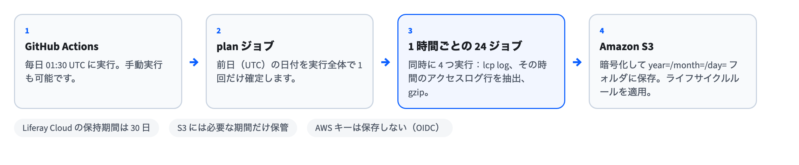

# Liferay Cloud の Web サーバーログをバックアップ
{: .no_toc }

Liferay Cloud は、`webserver` サービスの nginx アクセスログを直近 30 日分だけ保持します。このチュートリアルでは、スケジュール実行の GitHub Actions ジョブを設定し、ログを UTC の 1 時間ごとに 1 つの圧縮ファイルとして、自社で管理する Amazon S3 バケットにコピーします。セキュリティ、監査、コンプライアンスの要件に合わせて、必要な期間だけ保管できます。対象は、Liferay Cloud（PaaS）の管理者と、一緒に作業する AWS や DevOps のエンジニアです。

このチュートリアルの英語版は [PDF でもダウンロード](../Liferay-Cloud-Webserver-Log-Backup-Guide.pdf)できます。

1. TOC
{:toc}

## 作るもの

毎日 01:30 UTC に、GitHub Actions のワークフローが前日（UTC）分のログをバックアップします。

{: .screenshot }

| ステップ | 内容 |
| --- | --- |
| ** 計画 ** | 短いジョブが、実行全体で使う「前日」の日付を 1 回だけ確定します。 |
| ** 取得 ** | 24 個のジョブが数個ずつ並行して Liferay Cloud CLI（`lcp`）でサインインし、それぞれ UTC の 1 時間分の `webserver` ログを読み込みます。 |
| ** 抽出と圧縮 ** | 各ジョブは、担当する 1 時間のタイムスタンプを持つアクセスログ行だけを残し、gzip で圧縮します。 |
| ** 保存 ** | ファイルを暗号化して S3 バケットの `year=/month=/day=` フォルダに保存します。ライフサイクルルールで、安価なストレージへの移動と削除を自動化します。 |

結果として、環境ごと 1 時間ごとに 1 つのファイルができます。例：`liferay-cloud/myproject-prd/webserver/year=2026/month=11/day=24/webserver-myproject-prd-2026-11-24T13.log.gz`。`zgrep` や Amazon Athena ですぐに検索できます。GitHub は有効期間の短い OIDC 認証情報で AWS にサインインするため、AWS のアクセスキーはどこにも保存しません。

1 日分を 1 時間ごとの 24 ジョブに分けて取得するので、アクセスの多いサイトでも各ジョブは短時間で終わります。1 分あたり約 11,000 行のログが出るサイトでは、1 日分を 1 つのジョブで取得すると GitHub の 6 時間の上限を超えますが、1 時間ごとのジョブを 4 つずつ並行して実行すれば、推定 1.5〜2 時間で完了します。

## 始める前に

- **Liferay Cloud:** `webserver` サービスを含む Liferay Cloud（PaaS）プロジェクト。Liferay Cloud CLI 3.24.0 と `liferaycloud/nginx:1.31.0-6.8.0` の Web サーバーイメージで検証しています。
- **AWS:** S3 バケット、IAM ロール、OpenID Connect の ID プロバイダーを作成できるアカウントと、[AWS CLI](https://docs.aws.amazon.com/cli/latest/userguide/getting-started-install.html)。
- **GitHub:** Actions が有効で、シークレットを追加できるリポジトリ。Liferay Cloud のプロジェクトリポジトリでも、運用用の別リポジトリでもかまいません。
- **Liferay Cloud のサービスユーザー:** 対象の環境を参照でき、Liferay Cloud のパスワードを持つ専用アカウント。SSO で作成したアカウントには、設定するまでパスワードがありません。
- ** 所要時間:** 約 2 時間。さらに、最初のスケジュール実行まで 1 日かかります。

このチュートリアルでは、次のプレースホルダーを実際の値に置き換えてください。

| プレースホルダー | 意味 | 例 |
| --- | --- | --- |
| `<PROJECT_ID>` | Liferay Cloud の環境 ID（コンソールの URL に表示されます） | `myproject-prd` |
| `<BUCKET>` | S3 バケット名（全世界で一意） | `acme-liferay-logs` |
| `<AWS_REGION>` | バケットの AWS リージョン | `ap-northeast-1` |
| `<ACCOUNT_ID>` | 12 桁の AWS アカウント ID | `123456789012` |
| `<ORG>/<REPO>` | GitHub の組織とリポジトリ | `acme/liferay-ops` |

## 章

| 章 | 内容 |
| --- | --- |
| [1. S3 バケットを作成する](chapters/create-bucket.html) | 保持ルール付きの非公開・暗号化バケットを作ります。 |
| [2. GitHub と AWS を接続する](chapters/connect-github-to-aws.html) | OIDC の ID プロバイダーと、ログのアップロードしかできないロールを作ります。 |
| [3. Liferay Cloud にサインインする](chapters/liferay-cloud-sign-in.html) | ワークフローが無人でサインインできるサービスユーザーを用意します。 |
| [4. バックアップスクリプトを追加する](chapters/backup-script.html) | 1 時間分のログを取得、抽出、圧縮してアップロードするスクリプトです。 |
| [5. ワークフローを追加する](chapters/workflow.html) | 1 時間ごとの 24 ジョブを実行するスケジュールワークフローです。 |
| [6. テストして本番運用を始める](chapters/test-and-go-live.html) | 手動実行、確認、本番開始前のチェックリストです。 |
| [7. 日々の運用](chapters/operate.html) | 失敗時の再実行、ログの検索、アクセス管理、大量のログへの対応です。 |

## ステータス

* 一部のみ検証済みです。* スクリプトが前提とする Liferay Cloud CLI の動作は、CLI 3.24.0 で Liferay Cloud の開発環境に対して確認しました。また、Ubuntu 24.04 上でその環境に対して、1 時間ごとの 24 ジョブすべてを含め、スクリプトをドライランモード（アップロードなし）で最後まで実行しました。未検証の項目は、S3 へのアップロードと IAM ロール、パスワードによるサインイン、GitHub Actions のマトリクス実行そのものです。大量のログでの実行時間は、お使いの環境で測定するまでは推定値です。
